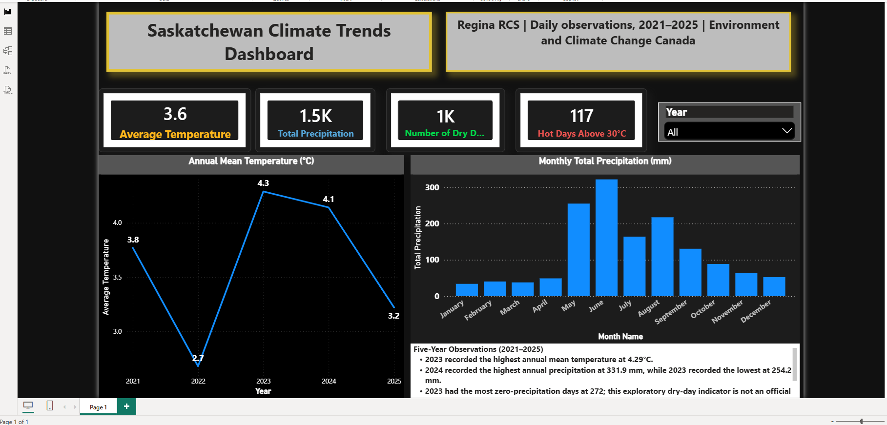

# Saskatchewan Climate Trends Dashboard

An interactive Power BI project analyzing temperature and precipitation trends in Regina, Saskatchewan, from 2021 to 2025.

## Live Dashboard

[View the Interactive Power BI Dashboard](https://app.powerbi.com/view?r=eyJrIjoiNWIwMmI0ZjEtMjliZC00NGVmLThmMzUtMzM3ZWVjYmM0M2Y5IiwidCI6IjMyMzNmZmExLWVhMDUtNDQ0NS04OTU4LTZiNjc0NDcyMzE0NyJ9)

## Dashboard Preview

## Project Overview

This project combines and analyzes 1,826 daily climate observations from Regina RCS, covering January 2021 through December 2025.

The dashboard examines:

- Annual mean temperature
- Monthly precipitation
- Zero-precipitation days
- Days with maximum temperatures above 30°C
- Interactive results by year

## Key Findings

- 2023 recorded the highest annual mean temperature at approximately 4.3°C.
- 2024 recorded the highest annual precipitation at 331.9 mm.
- 2023 recorded the lowest annual precipitation at 254.2 mm.
- 2023 had the most zero-precipitation days, with 272 days.

The zero-precipitation indicator is exploratory and is not an official drought classification.

## Project Workflow

1. Downloaded five years of daily climate data.
2. Combined the annual CSV files using Power Query.
3. Validated data types and handled missing observations.
4. Created analytical indicators and DAX measures.
5. Developed interactive charts, KPI cards, and a year slicer.
6. Published the finished report through Power BI Service.

## Tools and Skills

- Power BI Desktop
- Power BI Service
- Power Query
- DAX
- Data cleaning and validation
- Data visualization
- Climate-data analysis

## Data Source

Environment and Climate Change Canada Historical Climate Data:

- Station: Regina RCS
- Climate ID: 4016699
- Reporting frequency: Daily
- Period: 2021–2025

## Repository Contents

- `Saskatchewan Climate Trends Dashboard.pbix` — Power BI project file
- `dashboard-screenshot.png` — Dashboard preview
- Five annual ECCC CSV datasets covering 2021–2025

## Author

**Adewale Sogbesan**

[LinkedIn](https://www.linkedin.com/in/sogbesan-adewale-8b3882163) | [GitHub](https://github.com/Achiwallace)
